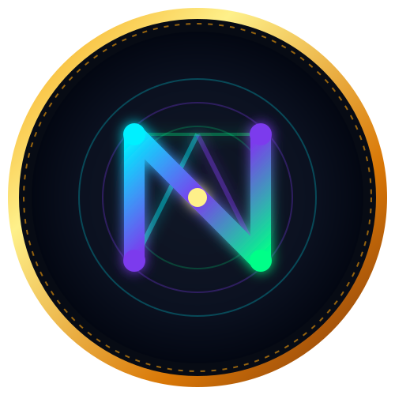

  

  # ⚡ NEXUS-QDAG Protocol (NXQ)

  **A Post-Quantum Resilient Layer-1 BlockDAG featuring Quantized zk-ML Proof-of-Useful-Work and Acoustic Air-Gapped Physical Transport.**

  
  
  
  
  

---

## 🪙 Spesifikasi Koin Resmi (NXQ Token)

| Parameter Moneter | Spesifikasi Protokol |
| :--- | :--- |
| **Nama Aset** | **NEXUS-QDAG** |
| **Simbol Ticker** | **NXQ** |
| **Total Pasokan Maksimal** | **2.100.000 (2,1 Juta) NXQ** (10x lebih langka dari Bitcoin) |
| **Alokasi Genesis Pendiri** | **210.000 NXQ (10%)** terkunci di Founder Vault |
| **Alokasi Penambangan Publik** | **1.890.000 NXQ (90%)** untuk penambang dunia |
| **Gas Fee Engine** | **0.005 NXQ** per transfer (Formula 50% Burn, 30% Dividen, 20% Treasury) |

---

## 🔬 Inovasi Fundamental

1. **Post-Quantum Cryptography (PQC):** Skema kisi (*Lattice-based ML-DSA*) dengan *Delayed Public Key Revelation* untuk efisiensi RAM.
2. **Proof of Useful Work (Quantized zk-ML):** Miner melatih neural network bilangan bulat murni (INT32) dengan bukti ZK instan.
3. **BlockDAG & BFT Epoch Anchor:** Graf paralel berkecepatan tinggi bebas orphan block dan tahan partisi jaringan.
4. **Multi-Modal Physical Transport (Air-Gap):** Transaksi nir-internet menggunakan frekuensi suara (*Acoustic-OFDM*) 17.5–19.0 kHz.

---

## 📱 Akses Portal Resmi & Web Wallet
Kunjungi portal interaktif dan dompet biometrik resmi langsung dari browser:  
👉 **[https://madesuke85-sketch.github.io/nexus-qdag-protocol/](https://madesuke85-sketch.github.io/nexus-qdag-protocol/)**

---

---

## 👑 Kepemimpinan & Arsitek Protokol
- **Founder & Lead Protocol Architect:** **Made Suke Raditia**
- **Genesis Founder Vault:** 210.000 NXQ (10% Pasokan Global Terkunci)
- **Repositori Resmi:** [github.com/madesuke85-sketch/nexus-qdag-protocol](https://github.com/madesuke85-sketch/nexus-qdag-protocol)

## 📜 Lisensi
Didistribusikan di bawah Lisensi Terbuka MIT.
